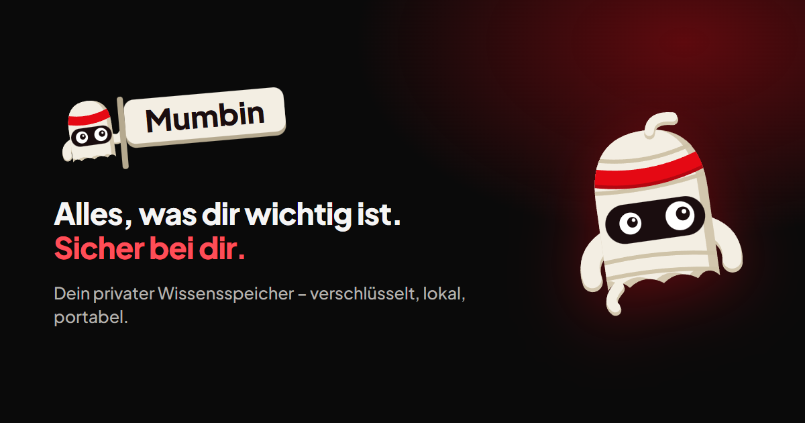
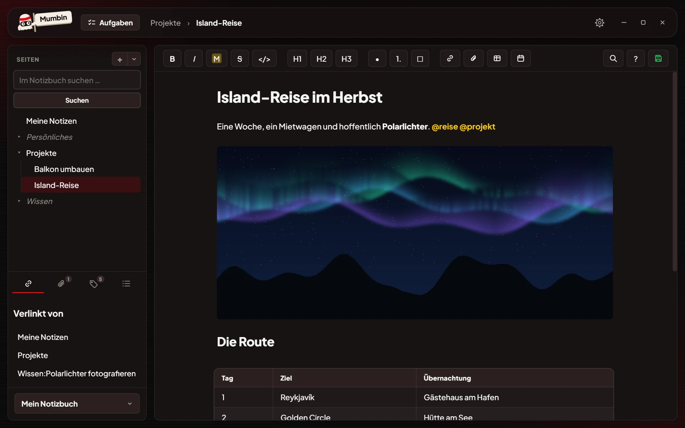

<p align="center"></p>

# Mumbin

**Alles, was dir wichtig ist. Sicher bei dir.**

Dein privater Wissensspeicher für Windows: Notizen, Dokumente und Aufgaben, optional mit
Verschlüsselung einzelner Seiten, eigenen Seitenpasswörtern und vollständig geschützten Notizbüchern. Eine portable EXE, kein Konto.

- [Website (Deutsch)](https://mumbin.com/)
- [Website (English)](https://mumbin.com/en/)
- [Blog (Deutsch)](https://mumbin.com/blog/) · [Blog (English)](https://mumbin.com/en/blog/)
- [Download und Prüfsumme](https://github.com/markmarkinson/mumbin/releases/tag/current)
- [Entschlüsselungs-Werkzeug](tools/README.md)
- [Lizenz (Source-Available)](LICENSE)
- [Drittanbieter-Lizenzen](https://mumbin.com/third-party-notices.html)



## Status

Version 0.1.0. Die EXE ist
nicht codesigniert. Windows 10/11 (64 Bit) und Microsoft Edge WebView2 Runtime werden benötigt.
Die Veröffentlichung enthält keine Cloud-Synchronisation und kein integriertes Backup.

Dieses öffentliche Repository enthält immer einen aktuellen Quellstand als **einzelnen
Root-Commit**, einschließlich Website. Die Entwicklungshistorie wird separat geführt.
`main` und `current` werden bei einer Veröffentlichung ersetzt; für eigene Arbeit einen Fork
oder eine lokale Kopie behalten.

Der Code ist öffentlich einsehbar. Eine Open-Source-Lizenz ist derzeit nicht vergeben;
es werden dadurch keine zusätzlichen Nutzungsrechte am eigenen Quellcode eingeräumt.
Die Lizenzen der Drittanbieter-Komponenten gelten unverändert.

## Funktionen

- Seitenbaum, Suche, Tags, Verweise und Rückverweise
- Editor mit Formatierung, Tabellen, Bildern und Anhängen
- Aufgaben mit optionalem Beginn und Frist
- Tresor-Verschlüsselung, eigene Seitenpasswörter, versiegelte Notizbücher
- HTML-Export, Druckansicht und unabhängiges Python-Entschlüsselungswerkzeug
- Deutsche und englische Oberfläche

Bei versiegelten Notizbüchern sind Seiten-/Anhangsnamen verborgen; Notizbuchname und Teile
der Struktur bleiben sichtbar. Exporte und bewusst extern geöffnete Dateien können Klartext
enthalten. Ohne das richtige Passwort gibt es keine Wiederherstellung. Passwortwechsel nicht
unterbrechen: Ein Absturz beim Austausch von Dateien kann Anhänge unter dem bisherigen
Schlüssel zurücklassen.

## Bauen und prüfen

Voraussetzungen: Windows, Rust (MSVC), C++ Build Tools, Node.js, WebView2.

```sh
npm ci
npm run dist:portable
cargo test --workspace
npm test
npm run test:e2e
```

Ergebnis: `dist/portable/mumbin.exe`. `MUMBIN_EXE` kann für E2E auf die gewünschte EXE zeigen.
`scripts/testCore.ps1` bereitet unter Windows die Junction-Testdaten vor. Für den Python-Test
werden Python und PyNaCl benötigt (`MUMBIN_REQUIRE_PYTHON=1` macht diesen Test verpflichtend).

## Website

Statische deutsche und englische Seiten in `docs/`, veröffentlicht mit GitHub Pages.
Texte in `docs-src/content.js`; erzeugen mit `npm run site:build`.
Screenshots zeigen die echte App mit ausschließlich künstlichen Beispieldaten;
Aufnahmeskript: `tests/e2e/siteScreenshots.mjs`.

Copyright © 2026 markMarkinson. Alle Rechte vorbehalten, soweit nicht anders angegeben.

## Lizenz

**Kostenlos nutzbar, Quellcode öffentlich einsehbar.** Die [Mumbin Source-Available License 1.0](LICENSE)
erlaubt, das unveränderte Programm privat und intern in Organisationen zu nutzen und den Quellcode zu
lesen. Vollständige, unveränderte offizielle Versionen dürfen unentgeltlich nicht-kommerziell weitergegeben
werden. Änderungen, veränderte Versionen und kommerzielle Weitergabe brauchen eine schriftliche Erlaubnis.
Es ist keine Open-Source-Lizenz im Sinne der OSI. Drittanbieter-Komponenten behalten ihre eigenen Lizenzen.
